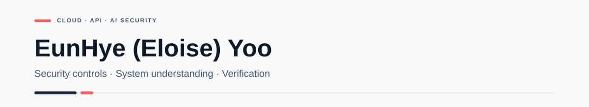

  

<strong>Cloud & AI Security</strong>

<a href="./README.md">한국어</a> · <a href="https://app.notion.com/p/3dd1b198732a8059b1b1f2f410f08dc6">Technical Notes</a>

I’m EunHye Yoo, preparing for security solution implementation/support and cloud security roles. I build REST APIs with Java/Spring and configure servers and networks with Linux and AWS to understand how services work and how requests reach them.

## Projects

### [OTTer Shield](https://github.com/team-blocks-lab/otter-shield) · In progress

A team project building hybrid infrastructure and testing security for an OTT service. **My responsibilities: project management, application development, and the M5 Canada branch network/AWS setup.**

**Intranet · REST API development and testing**

- Built login/logout, post CRUD, image-attachment APIs, and the React UI
- Tested requests and responses with Postman and checked MySQL data to verify creation, updates, and deletion
- Implemented server-side session login; verified rejection of unauthenticated requests (`401`) and invalid input such as blank titles (`400`)
- Implemented BCrypt password handling and post-author checks

[API test report and screenshots](https://github.com/team-blocks-lab/otter-shield/blob/main/apps/m1-intranet/docs/TEST_REPORT.md) · [Source code](https://github.com/team-blocks-lab/otter-shield/tree/main/apps/m1-intranet/backend)

**OTT service · Member and video APIs**

Built signup/login, public-video lookup, and playback APIs. Responses depend on session state and video publication status; checked API/React integration locally.

[Implementation and tests](https://github.com/team-blocks-lab/otter-shield/tree/main/apps/m3-ott)

**Canada branch and AWS · Extending security practice**

Configured basic connectivity for a Sophos UTM and five PCs. Built VPC/subnets/NAT with AWS CloudFormation and confirmed the EKS control plane was active.

I plan to extend my part of the project by testing VPN business traffic and restrictions on database/management-service access. On AWS, I plan to review administrative permissions and application-to-database access paths.

[M5 technical notes](https://app.notion.com/p/3ff1b198732a81c19379cd1f5730afbe) · [Security extension plan](./docs/security-plans/m5-access-boundaries.en.md)

### [Full-Stack Integration Lab](https://github.com/Eunhye-yoo/fullstack-integration-lab)

**A personal lab connecting web requests to a database across separate Linux servers.**

- Deployed React, Spring Boot, and MySQL to separate Ubuntu VMs
- Configured a Linux NAT router, IP forwarding, MASQUERADE/DNAT, and SSH/SCP
- Compared API responses, browser output, and database records to check the complete path
- Investigated connection issues by separating gateway, DNS, proxy, and database settings

[3-Tier lab and tests](https://github.com/Eunhye-yoo/fullstack-integration-lab/tree/main/02-linux-3tier) · [Commands and troubleshooting](https://app.notion.com/p/3ed1b198732a815091d2e0030512f175)

### [EduPOP](https://github.com/Eunhye-yoo/EduPOP)

A team project for academy operations and learning management. **I implemented class management, teacher/student assignment, dashboards, and individual performance reports.**

Built class creation, multi-instructor/student mapping, and duplicate/capacity checks. Class-detail requests compare the logged-in user’s academy with the requested class’s academy. Connected the Controller, Service, MyBatis, and database layers.

[My implementation and access-control review](https://github.com/Eunhye-yoo/EduPOP/blob/main/docs/access-control-review.en.md) · [Portfolio PDF, Korean](https://github.com/Eunhye-yoo/EduPOP/blob/main/docs/EduPOP_Portfolio_Eunhye_Yoo.pdf) · [Demo video](https://youtu.be/mkAcPCD7VOY)

## Skills

### Development & API Testing

  
  
  
  
  
  
  

REST APIs · Session authentication · Input validation · Postman request/response checks · MySQL data verification

### Infrastructure & Security

  
  
  
  
  

- **Linux · SSH:** Remote server access, application/DB separation, connection troubleshooting
- **Routing · NAT:** IP forwarding, MASQUERADE/DNAT, checking traffic paths between servers
- **Sophos UTM:** Separate OPS/CONTENT/MGMT networks and basic connectivity setup
- **AWS:** VPC/subnets/NAT and EKS cluster IAM role setup

[Cloud & API Security Lab plan](./docs/cloud-api-security-lab/README.en.md)

## Certifications

- **Network Administrator Level 2, Korea** — Certified
- **Engineer Information Processing, Korea** — Written exam passed
- **Linux Master Level 2, Korea** — First-stage exam passed

## Technical Notes & English

I keep source code and API tests on GitHub, and infrastructure configurations, commands, and troubleshooting notes on [Notion](https://app.notion.com/p/3dd1b198732a8059b1b1f2f410f08dc6).

I studied and lived in Canada, majored in commerce, and worked in English education. I use this background to read technical documentation and communicate in English.
