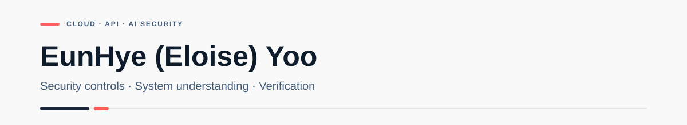

  

<strong>보안 솔루션 구축·기술지원 · 클라우드 보안</strong>

<a href="./README.en.md">English</a> · <a href="https://app.notion.com/p/3dd1b198732a8059b1b1f2f410f08dc6">기술 기록</a>

## 유은혜 | EunHye Yoo

**사람 사이에서는 팀의 소셜 허브, 일 앞에서는 먼저 움직이는 실행가.**

사람들과 잘 어울리고 필요한 일에는 먼저 나섭니다. 다양한 문화권에서 생활하고 일하며 상대의 이야기를 듣고 쉽게 설명하는 힘을 길렀고 사람들 앞에서 발표하는 데도 자신이 있습니다.

보안 솔루션 구축·기술지원 직무를 목표로 Linux·네트워크·AWS 환경 구성, 웹 서비스 개발·API 테스트를 해왔습니다. 직접 만들고 동작을 확인하고 막히는 부분은 해결해 가며 기술 역량을 쌓고 있습니다.

## 기술 스택

**보안·네트워크**

  
  
  
  

**클라우드·인프라**

  
  
  
  

**개발·API 검증**

  
  
  
  
  
  
  

세션 인증 · 입력값·소유권 확인 · HTTP 정상·예외 응답 테스트 · API 처리 결과와 DB 데이터 대조

## 대표 프로젝트

### [OTTer Shield](https://github.com/team-blocks-lab/otter-shield)
OTT 서비스를 위한 하이브리드 인프라·보안 팀 프로젝트 · 2026.10–11

**담당 범위: 캐나다 지사망 · 사내 게시판·OTT·굿즈 Store 웹 · 클라우드 인프라**

- Sophos UTM 구역 분리와 PC 네트워크 설정, 지사 간 VPN·DB 연동
- AWS CloudFormation 기반 VPC·서브넷·NAT·EKS 구성 및 서비스 배포·도메인 연결
- React·Spring Boot 기반 게시판·OTT·굿즈 Store 웹, ERD·REST API 설계·개발
- 로그인·세션·게시글 CRUD·이미지 첨부 API 구현, Postman·HTTP 상태 코드·MySQL 데이터로 동작 검증
- LLM 기반 자막 생성 기능 개발

[게시판 API 테스트 보고서](https://github.com/team-blocks-lab/otter-shield/blob/main/apps/m1-intranet/docs/TEST_REPORT.md) · [OTT 구현 자료](https://github.com/team-blocks-lab/otter-shield/tree/main/apps/m3-ott) · [캐나다 지사 기술 기록](https://app.notion.com/p/3ff1b198732a81c19379cd1f5730afbe)

### [Linux 3-Tier · Network Lab](https://github.com/Eunhye-yoo/fullstack-integration-lab)
웹·애플리케이션·DB를 분리하고 통신 경로를 확인한 개인 실습

- Ubuntu VM 3대에 React·Spring Boot·MySQL 분리 구성 및 CRUD 연동
- Linux NAT Router, IP Forwarding, MASQUERADE·DNAT, SSH/SCP 구성
- DB 외부 접속 권한·연결값 설정 및 원격 DB 연결 확인
- Netplan 설정 충돌 해결, 재부팅 후 IP·경로·NAT 유지 점검

[3-Tier 실습·검증](https://github.com/Eunhye-yoo/fullstack-integration-lab/tree/main/02-linux-3tier) · [명령어·문제 해결 기록](https://app.notion.com/p/3ed1b198732a815091d2e0030512f175)

### [EduPOP](https://github.com/Eunhye-yoo/EduPOP)
학원 운영·성적 분석 웹 서비스 · 5인 팀 · 2026.08–09

**담당: 서비스 아이디어 제안 · 반 관리·성적 분석 기능 개발 · 최종 발표**

- Spring Boot·MyBatis 기반 반 생성·수정·상태 관리 기능 개발
- MySQL 기반 학생 배정·다중 강사 매핑, 중복·정원·소유권 확인 및 Soft Delete 적용
- Chart.js 기반 반별 대시보드·개인 성적표 구현
- 성취도 조회 로직 공통화 및 팀원 월간 리포트 연동
- 최종 발표 자료 정리 및 발표 진행

[본인 구현·접근통제 검토](https://github.com/Eunhye-yoo/EduPOP/blob/main/docs/access-control-review.md) · [포트폴리오 PDF](https://github.com/Eunhye-yoo/EduPOP/blob/main/docs/EduPOP_Portfolio_Eunhye_Yoo.pdf) · [시연 영상](https://youtu.be/mkAcPCD7VOY)

## 자격증

- **네트워크관리사 2급** — 취득
- **정보처리기사** — 필기 합격
- **리눅스마스터 2급** — 1차 합격

## 기록과 소통

GitHub에는 코드와 테스트 자료를, [Notion](https://app.notion.com/p/3dd1b198732a8059b1b1f2f410f08dc6)에는 인프라 설정·명령어·문제 해결 과정을 기록합니다. 캐나다에서 경영학을 공부하고 일한 경험을 영문 기술문서 읽기와 영어 소통에 활용합니다.
