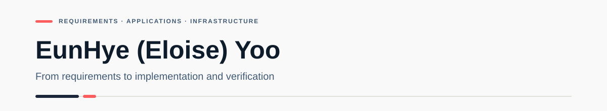

  

  <strong>Connecting requirements, applications, and infrastructure through implementation and verification.</strong>

  
  
  
  

  <a href="./README.ko.md">한국어</a>
  &nbsp;·&nbsp;
  <a href="https://github.com/Eunhye-yoo/EduPOP">EduPOP</a>
  &nbsp;·&nbsp;
  <a href="https://github.com/Eunhye-yoo/fullstack-integration-lab">Full-Stack Lab</a>
  &nbsp;·&nbsp;
  <a href="https://app.notion.com/p/Infrastructure-Lab-3dd1b198732a8059b1b1f2f410f08dc6?source=copy_link">Infrastructure Lab</a>

---

## 01 · About

I explore how **requirements, application features, data, and server/network environments** fit together in a working system. In EduPOP, I helped define service requirements and implemented class-management and analytics features. In the Full-Stack Integration Lab, I verified React–API–MySQL integration and communication across Linux VMs using routing and NAT.

Before moving into IT, I coordinated instructors, students, schedules, and customer needs in education operations. I bring that perspective to requirement analysis and team projects, documenting what I actually built, configured, and verified.

---

## 02 · Tech Stack

### Application & Data

Version badges refer to EduPOP. Integration labs and practice projects use their own Java, Spring Boot, and MyBatis starter versions.

### Infrastructure & Network

**Configuration labs:** [Linux 3-Tier (React / Spring Boot / MySQL)](https://github.com/Eunhye-yoo/fullstack-integration-lab/tree/main/02-linux-3tier) · AWS EC2/VPC/ALB (Linux httpd, Windows IIS, Bastion Host)

**Currently studying:** Docker · LLM / Generative AI applications

### Tools

---

## 03 · Selected Work

### [EduPOP](https://github.com/Eunhye-yoo/EduPOP)

> **An education platform that connects academy operations and test results to the next learning cycle**

`Java` `Spring Boot` `MyBatis` `MySQL`

- **Problem & requirement definition** — Proposed the original concept and translated academy-operation and learning needs into core service flows and feature scope
- **Class management implementation** — Implemented class creation and updates, student/multi-instructor assignment, duplicate and capacity checks, and status-based class closure
- **Pre-Class Dashboard** — Built class/student performance summaries and weak-area signals to support a three-minute pre-class review goal
- **Student Performance Report** — Implemented score trends and strength/weakness analysis, with analytics logic reused in monthly reporting code

> **Scope note:** Three minutes is a design goal, not a measured result. Assignment/access checks differ by path, and the parent-facing report share link is unfinished.

[Project README](https://github.com/Eunhye-yoo/EduPOP) · [Planning & Implementation Portfolio (PDF · Korean)](https://github.com/Eunhye-yoo/EduPOP/blob/main/docs/EduPOP_Portfolio_Eunhye_Yoo.pdf) · [Demo Video](https://youtu.be/mkAcPCD7VOY)

### [Full-Stack Integration Lab](https://github.com/Eunhye-yoo/fullstack-integration-lab)

> **Hands-on integration labs connecting frontend, backend, database, Linux servers, and network paths**

`React` `Spring Boot` `MyBatis` `MySQL` `Linux` `Routing/NAT`

- **Application integration** — Verified React → Vite Proxy → Spring Boot → MyBatis → MySQL CRUD flow and corrected environment-specific datasource/API configuration
- **Linux 3-Tier environment** — Separated React, Spring Boot, and MySQL across Ubuntu VMs with static IPs and remote database access
- **Network extension** — Added a Linux NAT Router, IPv4 forwarding, MASQUERADE, SSH/SCP, and DNAT port forwarding, then verified the full Windows → Router → React → Spring Boot → MySQL path

- **Express API** — Added Express source and verified query, path, and JSON body handling with GET/POST/PUT/DELETE responses. PUT/DELETE are learning examples without database persistence.

[Repository](https://github.com/Eunhye-yoo/fullstack-integration-lab) · [Detailed Infrastructure Lab](https://app.notion.com/p/Infrastructure-Lab-3dd1b198732a8059b1b1f2f410f08dc6?source=copy_link)

---

## 04 · Practice & Study

| Repository | Focus |
| --- | --- |
| [Spring Boot Practice](https://github.com/Eunhye-yoo/springBoot_practice) | Spring MVC · Thymeleaf · Interceptor/AOP · JPA · QueryDSL |
| [React Practice](https://github.com/Eunhye-yoo/react_practice) | JavaScript · Components · Hooks · Router · State |
| [Servlet Practice](https://github.com/Eunhye-yoo/servlet_practice) | Servlet · JSP · JDBC · Session · Request flow |
| [Study Log](https://github.com/Eunhye-yoo/study_log) | Network · Routing · Server · IT fundamentals |

---

## 05 · Certifications

- **Network Administrator Level 2 (Korea)** — Certified
- **Engineer Information Processing (Korea)** — Written exam passed
- **Linux Master Level 2 (Korea)** — Written exam passed

---

## 06 · Infrastructure Lab

Documentation covers **Linux 3-Tier · Network · Server** configuration, integration, verification, and troubleshooting. Separate hands-on AWS practice includes **EC2, VPC, ALB, and Bastion Host**. I am currently studying **LLM / Generative AI and Docker**.

[GitHub Full-Stack Integration Lab](https://github.com/Eunhye-yoo/fullstack-integration-lab) · [Notion Infrastructure Lab](https://app.notion.com/p/Infrastructure-Lab-3dd1b198732a8059b1b1f2f410f08dc6?source=copy_link)
